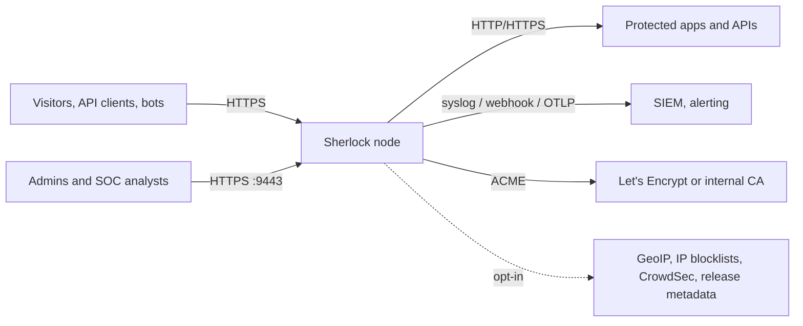
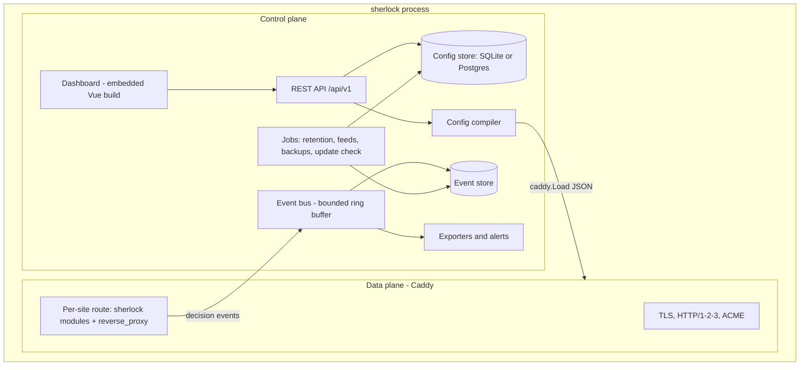
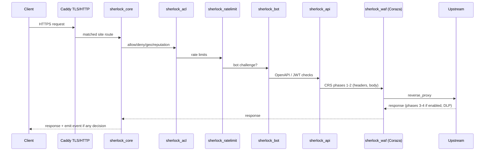

# Architecture overview

Sherlock is **one Go binary** that contains two planes running in one process:

- the **data plane**: an embedded Caddy server with Sherlock's own Caddy modules and the Coraza engine running OWASP CRS; it handles every proxied request;
- the **control plane**: an HTTP API, the embedded Vue dashboard, the config compiler, storage, the event pipeline, exporters and lifecycle jobs.

They share a process but not a listener: proxied traffic and admin traffic never use the same port, and a crash or restart of the control plane's HTTP server does not stop Caddy (NFR-4).

## System context

## Containers inside the binary

## Code layout

See [../engineering/repo-structure.md](../engineering/repo-structure.md) for the full tree. The important boundaries:

| Package | Responsibility | May import |
| --- | --- | --- |
| `cmd/sherlock` | CLI entry point (cobra) | everything internal |
| `internal/dataplane/...` | Caddy modules (one sub-package per module) | `internal/events`, `internal/policy`, Caddy, Coraza |
| `internal/policy` | Pure-Go evaluation logic shared by modules (rate-limit algorithm, IP matching, challenge tokens). No Caddy imports, so it is unit-testable | stdlib only, small libs |
| `internal/config` | Sherlock config model (Go structs), validation, YAML/JSON (de)serialisation, schema versioning | stdlib, yaml |
| `internal/compiler` | Turns a validated `config.Root` into Caddy JSON | `internal/config` |
| `internal/controlplane/api` | HTTP handlers, request validation, auth middleware | services below |
| `internal/controlplane/{auth,configsvc,eventsvc,users,audit,exporters,alerts,jobs,updater,backup}` | Services | `internal/store` |
| `internal/store` | Repositories over SQLite/Postgres (sqlc-generated queries), migrations (goose) | database drivers |
| `internal/events` | Event schema, bus, batch writer | `internal/store` |
| `internal/webui` | `embed.FS` of the built dashboard | none |
| `pkg/extension` | **Public** interfaces Enterprise implements (see [extension-points.md](extension-points.md)) | `internal` types are never exposed; only `pkg/...` types |
| `web/` | Vue 3 dashboard source | n/a |

## Configuration flow

1. A change arrives via the API (dashboard, CLI, or YAML import).
2. `configsvc` loads the current `config.Root`, applies the change, and runs **validation** (schema, references, SecLang syntax check by compiling the rules in a throwaway Coraza WAF instance).
3. `compiler` produces Caddy JSON. The compiler is deterministic: same input, byte-identical output (tested).
4. `configsvc` calls `caddy.Load(json, false)`. Caddy performs a graceful reload; existing connections finish on the old config.
5. On success, the new version is committed to `config_versions` with author and diff, and an audit entry is written. On failure, nothing is committed and the error is returned; Caddy keeps running the previous config.

Caddy's own admin endpoint is **disabled** (`"admin": {"disabled": true}`). Sherlock calls Caddy's Go API in-process, so there is no extra network surface.

## Request lifecycle (summary)

Full detail in [request-pipeline.md](request-pipeline.md).

Any module can terminate the request (block page, 429, challenge page). `sherlock_core` wraps the whole chain, owns the per-request decision record and emits exactly one event per request that had a decision.

## Deployment topologies

| Topology | Edition | Notes |
| --- | --- | --- |
| **Single node** on a VM in front of apps | OSS | Default. SQLite. Ports 80/443 public, 9443 admin restricted by firewall or bound to a private interface |
| **Behind a cloud load balancer** | OSS | Set trusted proxies (FR-PRX-5); TLS can terminate at the LB or at Sherlock |
| **Several independent nodes** | OSS | Each node has its own store; config managed as YAML in Git and applied with `sherlock config apply` or the API. Rate limits per node |
| **Kubernetes gateway** | OSS (M12) | Helm chart, Deployment + Service; config from a ConfigMap or the API |
| **Cluster with central control plane** | Enterprise | Shared Postgres + Valkey, config pushed to nodes, cluster-wide rate limits, HA |

## Cross-cutting decisions

| Concern | Decision | ADR |
| --- | --- | --- |
| Data plane | Caddy, embedded | [ADR-0002](adr/0002-caddy-as-data-plane.md) |
| Detection | Coraza v3 + OWASP CRS 4 embedded, own Caddy handler | [ADR-0003](adr/0003-coraza-and-crs.md) |
| Language and packaging | Go, single static binary, no CGO | [ADR-0004](adr/0004-go-single-binary.md) |
| Config model | Sherlock-owned model compiled to Caddy JSON | [ADR-0005](adr/0005-own-config-model.md) |
| Storage | SQLite default, Postgres optional; sqlc + goose | [ADR-0006](adr/0006-storage.md) |
| Events | In-process bounded bus, never blocks traffic | [ADR-0007](adr/0007-event-pipeline.md) |
| Dashboard | Vue 3 + TS, Vite, OpenVue, Tailwind v4, ECharts, Tabler icons | [ADR-0008](adr/0008-dashboard-stack.md) |
| Open core | AGPL core, Enterprise via public extension interfaces | [ADR-0009](adr/0009-open-core-extension-model.md) |
| Repos | Monorepo for core; separate private EE repo | [ADR-0010](adr/0010-repositories.md) |
| Rules updates | CRS shipped inside releases; CRS security fix → Sherlock patch release | [ADR-0011](adr/0011-rule-updates.md) |
| Policy hierarchy | Global → site → endpoint, resolved at compile time | [ADR-0012](adr/0012-policy-hierarchy.md) |
| CVE protection | Curated virtual-patching rule pack shipped in releases | [ADR-0013](adr/0013-virtual-patching-rule-pack.md) |
