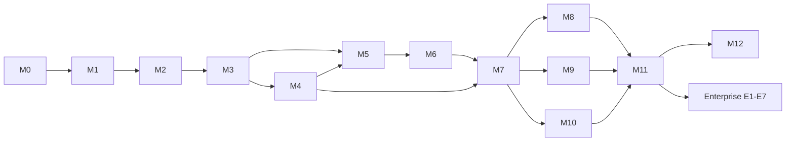

# Roadmap

Thirteen open-source milestones (M0–M12) in four phases, plus Enterprise milestones (E1–E7) planned in the enterprise repository. E1 (licensing and the Enterprise build) can start during Phase 3 so design partners can trial Enterprise; E2–E7 run in Phase 4. Durations assume milestone-sized bursts of work, each reviewed before the next starts; they are estimates to re-plan after each gate.

| Phase | Milestones | Target window (estimate) | Release at end | Gate to pass before next phase |
| --- | --- | --- | --- | --- |
| 1 · Foundation | M0, M1, M2 | Month 1 | `v0.1.0` | CRS regression (PL1) passes in CI; latency and throughput measured and NFR-1/2 budgets confirmed or revised by ADR |
| 2 · MVP | M3, M4, M5, M6, M7 | Months 2–4 | `v0.5.0` (MVP) | 3–5 design partners running Sherlock in detect mode on real traffic; installer works on fresh VMs; internal ASVS L2 review done |
| 3 · Competitive and finance-ready | M8, M9, M10, M11 | Months 5–9 | `v1.0.0` | External pentest passed (no open critical/high); 3 partners in block mode for 30 days |
| 4 · Scale | M12 + Enterprise E2–E7 (E1 in Phase 3) | Months 10–15 | `v1.1.0`+, `sherlock-ee 1.x` | — |

## Milestones

| ID | Name | Delivers (requirements) | Version |
| --- | --- | --- | --- |
| [M0](milestones/M00-bootstrap.md) | Repository bootstrap | Tooling, CI skeleton, governance files | — |
| [M1](milestones/M01-dataplane-core.md) | Data plane core | FR-PRX-1/2/3/5, FR-WAF-1/2/3/7/9, FR-POL-1/2/3 (file config) | — |
| [M2](milestones/M02-events-and-test-harness.md) | Events, metrics, test harness | FR-EVT-1/3/6, NFR-1/2/13 measurement | `v0.1.0` |
| [M3](milestones/M03-control-plane.md) | Control plane foundation | FR-CP-1…7, FR-EVT-2 | — |
| [M4](milestones/M04-dashboard-foundation.md) | Dashboard foundation | FR-CP-8 (part), FR-CP-9, FR-PRX-3/4/6/7, FR-WAF-9 | `v0.2.0` |
| [M5](milestones/M05-access-control-and-rate-limits.md) | Access control and rate limits | FR-ACL-1…6 | `v0.3.0` |
| [M6](milestones/M06-bot-defence.md) | Bot defence | FR-BOT-1…4 | `v0.4.0` |
| [M7](milestones/M07-mvp-completion.md) | MVP: explorer, analytics, install, updates | FR-CP-8, FR-FIN-3, FR-LC-1…3 | `v0.5.0` |
| [M8](milestones/M08-tuning-and-rules.md) | False-positive tuning, rule management, virtual patching | FR-WAF-4/5/6/8, FR-VP-1…6 | `v0.6.0` |
| [M9](milestones/M09-api-protection.md) | API protection | FR-API-1…4, FR-ACL-4 keyed | `v0.7.0` |
| [M10](milestones/M10-export-and-alerting.md) | SIEM export and alerting | FR-EVT-4/5 | `v0.8.0` |
| [M11](milestones/M11-finance-protections-and-1.0.md) | Finance protections, hardening, 1.0 | FR-FIN-1/2, NFR-6, pentest | `v0.9.0` → `v1.0.0` |
| [M12](milestones/M12-kubernetes-and-scale.md) | Kubernetes and scale | FR-LC-4, performance work | `v1.1.0` |

## Dependency graph

M8, M9 and M10 are independent of each other and can run in any order.

## Re-planning

After each gate, update this file: actual dates, what slipped, and whether the next phase's scope still makes sense. Never silently drop a requirement; move it to a later milestone and note it here.

| Gate | Planned | Actual | Notes |
| --- | --- | --- | --- |
| Phase 1 | Month 1 | | |
| Phase 2 | Month 4 | | |
| Phase 3 | Month 9 | | |
